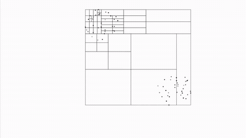

# n-body

Parallel Barnes-Hut Algorithm

<p align="center">

</p>

## Description

Program for simulating N-body systems. The algorithm is a parallel implemenation of the [_Barnes-Hut algorithm_](https://www.nature.com/nature/journal/v324/n6096/abs/324446a0.html) inspired by [_Salmon, John K.  Parallel hierarchical N-body methods. Diss. California Institute of Technology, 1991_](http://thesis.library.caltech.edu/6291/). The program can run on 2<sup>d</sup> process using MPI. 

A [simulation](https://www.youtube.com/watch?v=yFQX-5nmXYc) of two spinning disks and a [visualization](https://www.youtube.com/watch?v=KrtevnjgtgM) of the Barnes-Hut tree. 

## Installation

Install an MPI library such as [OpenMPI](https://www.open-mpi.org/) or [MPICH](https://www.mpich.org/). On macOS this can be done with [Homebrew](https://brew.sh/):

```
$ brew install mpich
```

Clone the git repository and build the program in some directory, e.g. `build`

```
$ git clone https://github.com/pbarkm/n-body.git  
$ cd n-body  
$ mkdir build
$ cd build
$ cmake ..
$ make
```
 
To start the program on two processes run

```
$ mpirun -np 2 ./n_body
```

The supplied python files for plotting require `matplotlib` and `numpy`.

## Running

To display the command line options run

```
$ mpirun -np 1 ./n_body -?
```

The following command runs a simulation of 1000 bodies for 10000 time steps. The sampled positions of the bodies are stored in positions.txt and the program is run with the verbose flag (-v).

```
$ mpirun -np 2 ./n_body -N 1000 -s 10000 -v -o positions.txt
```

A python script is supplied to animate the simulation.

```
$ python py/plot.py positions.txt
```


